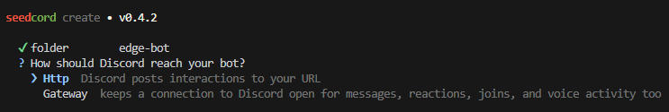
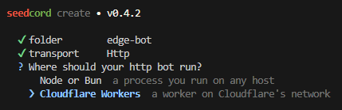
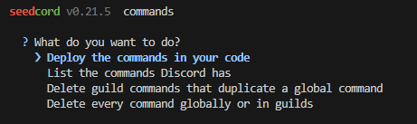
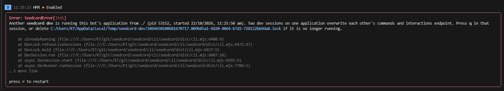

With v0.22, we're bringing Vite to production builds too! `seedcord dev` was already using Vite, and now `seedcord build` does as well. With Vite 8 (Rolldown), this means faster builds and more consistency between development and production. Previously, production builds were transpiled with TypeScript and their aliases rewritten with `tsc-alias`.

To upgrade your bot, run your package manager's upgrade command:

```sh
pnpm update --latest seedcord @seedcord/http
bun update --latest seedcord @seedcord/http
npm install seedcord@latest @seedcord/http@latest
yarn upgrade --latest seedcord @seedcord/http

# Replace @seedcord/http with your transport, and update any Seedcord plugins you use.
```

New to seedcord? Scaffold your first bot with our `create-seedcord` CLI:

```sh
pnpm create seedcord@latest
bun create seedcord@latest
npm init seedcord@latest
yarn create seedcord@latest
```

Then head over to [our first bot guide](https://seedcord.org/guide/first-bot/).

Curious what seedcord does and why? [Start here!](https://seedcord.org/guide/)

Here are some things from this release we'd like to highlight:

---

## Static builds with Vite & Vite plugin support

As mentioned above, this release features Vite builds for production (`seedcord build`). Before, only `seedcord dev` was using Vite, which meant we had two different build paths for dev and prod. As an additional pain point, the previous production build was more of a "transpilation": at runtime, your modules were still being dynamically read from the filesystem instead of statically imported.

By moving to Vite and unifying dev and build, we now have consistent parsing behaviour across dev and prod, as well as reduced complexity, and no more of that runtime module importing behaviour. _Hooray for all!_

Because we have now adopted Vite entirely, you can also use your own Vite plugins in the seedcord config file, like so:

```ts
import { defineConfig } from 'seedcord/config';
import { foo } from 'vite-plugin-foo';

export default defineConfig({
    // ...
    vitePlugins: () => [foo()]
});
```

Make sure that any environment-aware plugins target the `seedcord` environment, since that's the environment that seedcord is set up in.

You'll find more information about using Vite plugins, and when to use seedcord plugins vs Vite plugins, on [this guide page](https://seedcord.org/guide/build/vite-plugins/).

This upgrade solves our bundling problems and lets us do something else that's pretty cool:

---

## Edge bots

You can now write HTTP bots that run on the edge (Cloudflare Workers)! Previously, the option to run bots on Workers wasn't functional, and you only had the option to run it on a server runtime like Node. With this release, you can now write bots using seedcord that build as Cloudflare Workers. These bots use Discord's Interactions webhook capability to allow your bot to receive certain events as a webhook call to your bot instead of via the Gateway, and when you're done, you can deploy them to the Cloudflare Workers platform.

To get started, run either of these commands (depending on your package manager):

```sh
pnpm create seedcord
bun create seedcord
npm init seedcord
yarn create seedcord
```

Then select the HTTP bots option.



And finally select Cloudflare Workers.



Make sure to fill in the remaining details as requested, and then your bot should now be scaffolded.

> Note: The runtime option will only appear for HTTP bots.

Now, `cd` into your project directory:

```sh
cd edge-bot # replace with your bot's directory
```

And run `seedcord dev` with your package manager. Your bot will now be running and ready for you to iterate on. Edit a relevant file, and your bot will have hot module replacement (HMR) activating to swap out the module you just edited, faster than you can blink!

In dev, the bot is running inside `workerd`, the same runtime used by Cloudflare Workers. This ensures there are few differences between your local testing and the production runtime. This is possible thanks to us moving to use Vite for both dev and build, allowing us to fully utilise the [Vite Environment API](https://vite.dev/guide/api-environment). This system allows us to coordinate dev and build in a separate runtime like this and accurately map the `seedcord` application. Huge thanks to the Vite team for making this!

Before your first deploy, log in to Cloudflare and deploy your commands. The build reads their IDs from Discord:

```sh
pnpm exec cf auth login
pnpm exec seedcord commands deploy
pnpm build
pnpm exec cf deploy --prebuilt --secrets-file .secrets.env
```

Make sure `DISCORD_BOT_TOKEN` is available in your shell or `.env` when you build. Put it in `.secrets.env` too for the first deploy, and keep that file out of git. After the first deploy, the scaffold's `deploy` script builds and deploys without the secrets file. With Bun, use `bunx` for each `pnpm exec` command and `bun run build` for `pnpm build`. And voila! Now you've got a seedcord edge bot deployed to Cloudflare.

Set Discord's **Interactions Endpoint URL** to your Worker URL in the developer portal.

Read up on this in [the guide page](https://seedcord.org/guide/build/workers/).

---

## Command management via CLI

If you've ever deployed any bot to Discord (not just seedcord ones), you'll know that command management is a bit of a pain. There's no way to delete your registered commands in Discord's developer portal, whether they're global or guild commands.

That pain is no more for seedcord bots! Starting with this version, the framework CLI now has a `commands` subcommand, which is your home for managing command deployments.

Running `seedcord commands` gives you the following options:



- **Deploy the commands in your code** - seedcord will read your code, compile a list of commands, and deploy them according to how you configured your command (`guild` commands are deployed to a server of your choosing, `global` commands are deployed to the bot itself).
- **List the commands Discord has** - Lists the commands your bot has deployed globally or in servers.
- **Delete guild commands that duplicate a global command** - Removes guild commands that share a name with a global command.
- **Delete every command globally or in guilds** - Deletes every command your bot has registered, globally and/or in guilds. _**This is very destructive. Make sure you've selected the right bot and, if applicable, the right guild!**_

Each of these can also be accessed with subcommands:

- `deploy [options]`
- `list [options]`
- `clean [options]`
- `purge [options]`

This allows you to have simplified command management while building and maintaining your bot with seedcord!

To learn more about the subcommands, visit [this guide page](https://seedcord.org/guide/tooling/commands/).

---

## Library mode

seedcord bots can be built (and published) as libraries! This allows you to write your bots using the framework, and export them for use as part of a larger application. This will be most useful to bots on HTTP transports, as you can easily integrate them into backend frameworks like Hono, H3, Elysia, or even full-stack frameworks like Nitro, TanStack Start, Astro, and more.

To build library bots, omit `build.start` from your seedcord config:

```ts
import { defineConfig } from 'seedcord/config';

export default defineConfig({
    root: './src',
    instance: './bot.ts'
    // do not set build.start
});
```

And now, your bot will be packaged as a library, ready for you to reuse it elsewhere.

To use library bots, simply import them from their bot entrypoint:

```ts
import bot from '@mypkg/bot'; // Change the entrypoint to your bot package entrypoint
```

HTTP bots comply with the `export default { fetch }` standard used by Cloudflare Workers, Bun, Hono, H3, Elysia, and more. This means that you can simply pass in one `Request` object and get the `Response` from the bot. In a Node server, call `start()` before passing requests to `fetch()`; on Workers, the first request starts the bot. The [embedding guide](https://seedcord.org/guide/build/embed/) has an example.

For Gateway bots, start them using the `start` method:

```ts
await bot.start();
```

Your bot can now be used like a library in another app.

See [the guide](https://seedcord.org/guide/build/package/) to learn more. There's also [a guide page on integrating with web servers](https://seedcord.org/guide/build/embed/).

---

## Session lock files

Did you ever start a dev server and forget about it? Well, as a small new addition to this update, we've added a session lock file.

When you start a dev session, a lock file records the Discord application ID. If another dev session starts with the same application ID, the CLI shows the first session's folder, process id, start time, and lock file path. Press `q` in that session to stop it, or remove the lock if the session has already stopped.



This will not trigger if bots are using different applications, so it won't get in your way if you are developing several distinct bots.

---

## Other fixes and improvements

- ~40 bug fixes were included in this release
- `create-seedcord` got a refreshed look, asks if you want to install dependencies and initialize a git repo, and comes with a sample uptime plugin.
- The TUI is now more responsive for narrower screens (such as mobile or split screen on computers)
- Certain layout and filter preferences for dev sessions are now saved across sessions.
- The bot health check was revamped and now correctly says ready when the bot is actually ready for gateway and HTTP bots running on Node.

For the rest of the release information, [read the release changelog](https://github.com/seedcord/seedcord/releases/latest).

Join our [Discord server](https://seedcord.org/chat) to chat with others about seedcord!
